  

### 👋🏾 Salut, moi c'est Isabelle !

- 🔌 J'adore voir un projet passer du schéma à la carte soudée, puis au code : PCB sous Proteus, microcontrôleurs, LoRaWAN, ROS2, et des applications web pour exploiter les données.
- 🤖 En ce moment : un robot mobile autonome sous ROS2, avec une STM32, un LiDAR et une Raspberry Pi 5.
- 💧 Mon projet préféré : WaterPaid, un compteur d'eau prépayé connecté en LoRaWAN.
- 🎤 Hors du labo : du slam, devant plus de 100 personnes, et beaucoup de débats.

### 🛠️ Outils

  

  
  
  
  
  
  

---

### 🔋 Embarqué et IoT

<table>
<tr>
<td width="50%" valign="top">

#### 💧 WaterPaid, compteur d'eau prépayé
<!-- Remplace ce commentaire par le lien du dépôt WaterPaid quand il sera en ligne -->
Compteur connecté qui mesure la consommation et coupe l'eau quand le crédit est épuisé. Arduino Nano, module LoRaWAN RAK3112, réseau ChirpStack, recharge par Mobile Money.

**Ma part** (équipe de 12, 3 mois) : schéma synoptique, PCB sous Proteus, soudure, documentation des protocoles à partir des datasheets, relecture du rapport.

`Arduino` `LoRaWAN` `Proteus` `SPI` `I2C` `UART`

</td>
<td width="50%" valign="top">

#### 🤖 Robot mobile autonome
Projet annuel de l'ENSEA, en cours : un robot qui rallie un point B en autonomie en cartographiant la pièce.

Projet d'équipe en C et en Python, autour d'une STM32, d'un contrôleur de moteurs MD25, d'un LiDAR TSA 360 et d'une Raspberry Pi 5, reliés sous ROS2.

`STM32` `ROS2` `LiDAR` `C` `Python`

</td>
</tr>
</table>

### 💻 Logiciel

<table>
<tr>
<td width="50%" valign="top">

#### 📱 [Passerelle USSD](https://github.com/Isa-Christ/Network_projet_integration_USSD)
Rend des API REST utilisables en USSD depuis n'importe quel téléphone, même basique. Chaque service est un automate à états finis.

**Ma part** (équipe de 5) : l'IA qui convertit le JSON d'une API web vers le format de la machine à états, testée avec 3 services simultanés.

`Java 17` `Spring Boot` `WebFlux` `PostgreSQL`

</td>
<td width="50%" valign="top">

#### 🧾 Ordres de mission, stage à l'EDC
Juillet et août 2026. Application web qui remplace un circuit papier sous Word jusqu'à la direction générale : validation numérique, traçabilité du créateur, suivi de l'état, calcul automatique des frais, accès concurrents.

Code interne à l'entreprise, non publié.

`Node.js` `Next.js`

</td>
</tr>
<tr>
<td width="50%" valign="top">

#### 📅 [Gestionnaire d'événements](https://github.com/Isa-Christ/Projet-final-POO)
Application de bureau : concerts, conférences, participants, organisateurs, notifications en temps réel.

`Java` `JavaFX` `MVC` `Jackson` `JUnit 5`

</td>
<td width="50%" valign="top">

#### 🏅 Et aussi
- Certification Introduction au Machine Learning (2024)
- Cheffe de cellule formation au club Débat et Éloquence : 50 membres au niveau 1, 17 au niveau 2
- Slam sur le cancer du sein, le génie civil, les télécommunications ou la justice

</td>
</tr>
</table>

---

### 📊 Sur GitHub

  
  

🇫🇷 Français courant • 🇬🇧 Anglais intermédiaire

